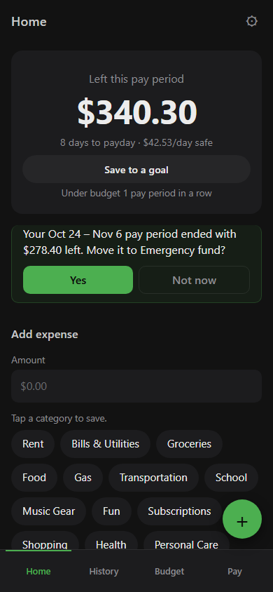
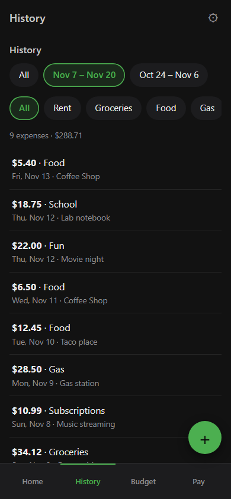
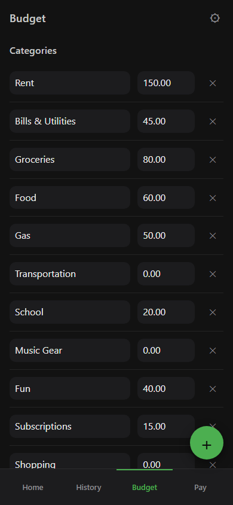
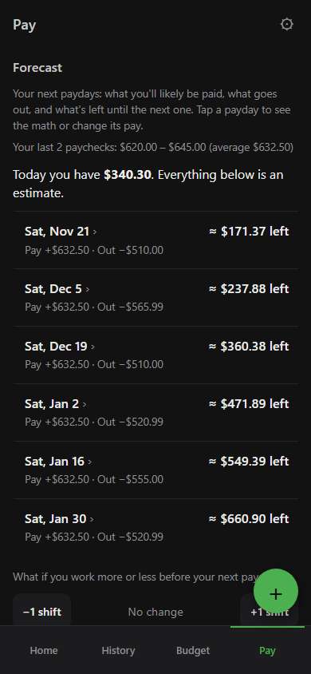

# Open Source Budget App

A simple paycheck-to-paycheck budget app for students and part-time workers. It runs in your browser, works offline, and keeps all your data on your own device.

**Try it:** https://opensourcebudgetapp.pages.dev

> **Made with AI.** This app was designed by its owner and written with the help of an AI coding assistant ([Claude Code](https://claude.com/claude-code) by Anthropic). The code has been reviewed and tested, but it comes with no guarantees: check the numbers against your real bank balance, and don't rely on it as financial advice.

| Home | History | Budget | Pay |
|:---:|:---:|:---:|:---:|
|  |  |  |  |

*Screenshots use made-up demo data.*

## Your data stays with you
- There's no account, no server and no tracking. Everything is saved in your browser on your device.
- Bank statements you import are read on your device and never uploaded.
- The site's security rules stop the app from sending data anywhere.
- Optional **app lock** encrypts your data with a passcode (AES-256). A forgotten passcode can't be recovered, so keep a backup.
- Clearing your browser data erases the app's data too. **Download backups regularly.**

## Getting started
1. Open the app on your phone and choose **Add to Home Screen** (Share menu on iPhone, ⋮ menu on Android). It then works like a normal app, even offline.
2. Tap **⚙** and set how often you get paid.
3. On **Pay**, add your latest paycheck.
4. On **Budget**, set how much you plan to spend per category each pay period, and add your monthly bills.
5. Log spending with the green **+** button, or by tapping a category on Home.

## What each screen does
**Home**
- How much you have left this pay period, days to payday, and a safe amount to spend per day.
- **Can I afford it?** Type a price to see if it fits before payday.
- Tips and savings nudges, like moving leftover money into a goal.

**History**
- Every expense, filterable by pay period and category. Tap one to edit it.

**Budget**
- Categories with planned amounts, bills with due days, and savings goals.
- Semester funds for big costs (like books) saved a little each paycheck.
- IOUs to track who owes whom.

**Pay**
- Paychecks and extra income.
- **Import from your bank:** CSV, PDF statement, or pasted transactions. You review each one before it's added, and duplicates are skipped.
- **Forecast:** your next paydays, what you'll likely earn and spend, and what's left. Add upcoming shifts for a better estimate, or tap a payday to see the math.

**⚙ Settings**
- Pay schedule, what happens to leftover money, low-money warning, overdraft/SpotMe limit, round-ups.
- **Match my bank balance** if the app and your bank ever disagree.
- Backup & restore, a backups folder (on desktop Chrome/Edge), app lock, and erase.

## Backups
⚙ Settings → **Download backup** saves a `.json` file. Restore it on any device with **Open backup files**. Backups contain your financial data, so keep them private: don't email them around or put them in public folders. Backups made while the app lock is on need the same passcode to restore.

## For developers
Plain HTML, CSS and JavaScript. No build step and no dependencies, except [pdf.js](https://mozilla.github.io/pdf.js/) loaded from a CDN with an integrity check for PDF import.

- Run locally: `python -m http.server 8123` in this folder, then open http://localhost:8123
- Before committing: `powershell -ExecutionPolicy Bypass -File .\check.ps1`
- Publishing and releasing: see [PUBLISHING.md](PUBLISHING.md)

Found a bug or a security problem? Open an issue. Please don't include real bank data or backups in it.
